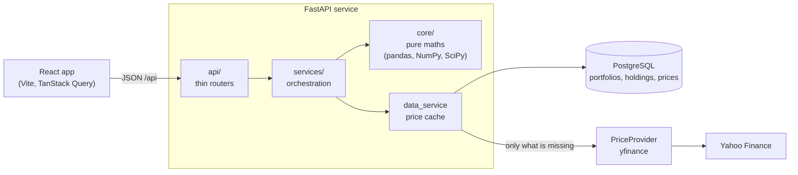
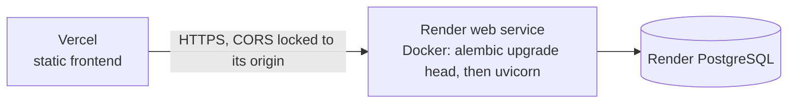

# Architecture

## Shape

A React single-page app talks JSON to a FastAPI service. The service keeps portfolios and a cache of
daily prices in PostgreSQL and fetches missing prices from Yahoo Finance. All the finance lives in
a package with no web or database imports.

## Layers and the rule between them

| Layer | Folder | Knows about | Never knows about |
|---|---|---|---|
| Core | `backend/app/core` | pandas, NumPy, SciPy | HTTP, SQL, settings |
| Services | `backend/app/services` | core, the database, the provider | HTTP |
| API | `backend/app/api` | services, schemas | maths |
| Schemas | `backend/app/schemas` | Pydantic | everything else |

The rule that matters: **no math in routers, no HTTP in the math.** A router parses parameters and
calls one service function. A service loads data, calls core functions and builds a response model.
A core function takes DataFrames or arrays and returns numbers, which is why every one of them can
be tested against a hand calculation without a database or a network.

## What happens on an upload

1. `POST /api/portfolios` reads the file, capped at 1 MB, and passes the bytes to
   `csv_import.parse_holdings_csv`, which validates every row and collects all problems.
2. `portfolio_service.create_portfolio` derives the currency from the tickers, rejects mixed
   currencies, picks the benchmark, and asks `DataService.get_prices` for three years of prices for
   every ticker. This is what proves each ticker exists, and it fills the cache.
3. The portfolio and its holdings are stored. The response is built by `describe_portfolio`, which
   values each holding at its latest cached price.

## What happens on an analysis request

1. `portfolio_service.load_market_data` reads prices through the cache, excludes holdings with too
   little history (with warnings), aligns the calendars, and derives log returns, values and weights.
   The result is a `MarketData` object shared by every analysis.
2. `risk_service`, `scenario_service` or `backtest_service` runs the core functions on it and builds
   the response.

On a warm cache the risk endpoint takes tens of milliseconds, because there is no network and the
matrices are small. The backtest takes a few hundred, almost all of it the daily Monte Carlo.
Measured numbers are in the README.

## The price cache

Prices are stored once per `(ticker, date)` in `prices`, shared by every portfolio. For each ticker
the data service looks up the first and last cached date (`missing_ranges`) and asks the provider
only for what lies outside. Hits and misses are counted and logged per request. The trade-offs, and
why bounds were preferred to a per-day gap check, are in `DECISIONS.md`.

## Errors

Services raise `AppError` subclasses (`errors.py`): invalid file, unknown tickers, insufficient
data, provider unavailable, not found. One set of handlers (`api/error_handlers.py`) turns them, and
validation errors, unknown routes and unexpected exceptions, into `{code, message, details}` with the
right status code. A middleware adds `X-Request-ID` to every response and logs one structured JSON
line per request. For an unexpected exception the client gets the request id, never the exception text.

## Frontend

`src/api` holds a typed fetch client and TanStack Query hooks. `src/pages` has one component per
screen; `PortfolioShell` loads the portfolio named in the URL once and passes it to the section pages
through router context. `src/charts` isolates Recharts, `src/theme` holds the design tokens and
styles. In development Vite proxies `/api` to port 8000. In production the app calls
`VITE_API_URL`.

## Deployment

`render.yaml` describes the API and its database, `backend/Dockerfile` builds the image,
`frontend/vercel.json` makes client-side routes fall back to `index.html`. CORS is read from
`CORS_ORIGINS`, so it is locked to the real frontend origin without a code change.

## Testing

| Where | What |
|---|---|
| `tests/unit/test_hand_calculation.py` | Reproduces `docs/hand_calculation.md` number for number |
| `tests/unit/test_*` for each core module | Edge cases and properties: contributions sum to volatility, VaR(99) >= VaR(95), CVaR >= VaR, no look-ahead in the backtest |
| `tests/unit/test_data_service.py` and others | Cache logic and portfolio rules against a fake provider |
| `tests/api` | Every endpoint through `TestClient` with fixture prices, no network |
| `frontend/src/**/*.test.*` | Formatting, API client, upload errors, chart text equivalents |
| CI | Ruff, mypy, pytest with an 85% gate on core and services, migrations on PostgreSQL, frontend lint, types, tests, build |
